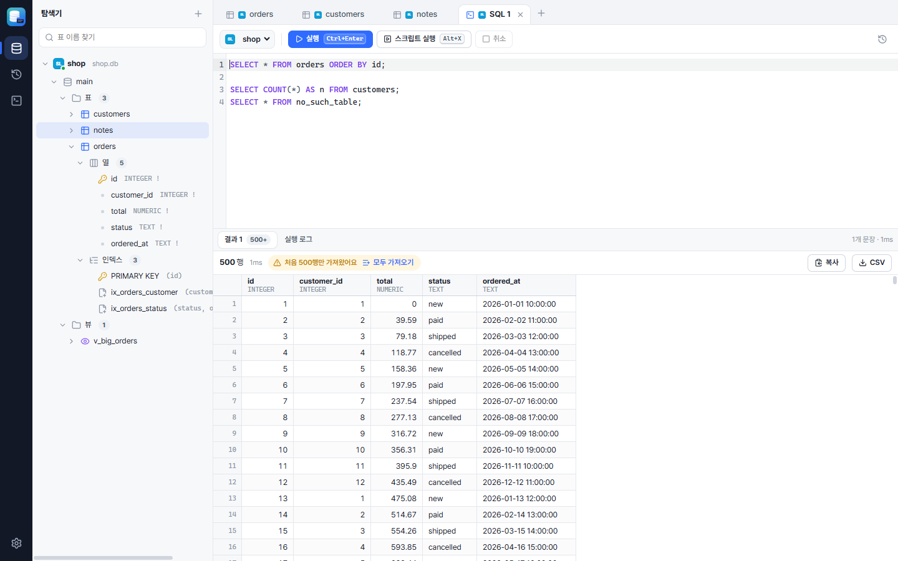
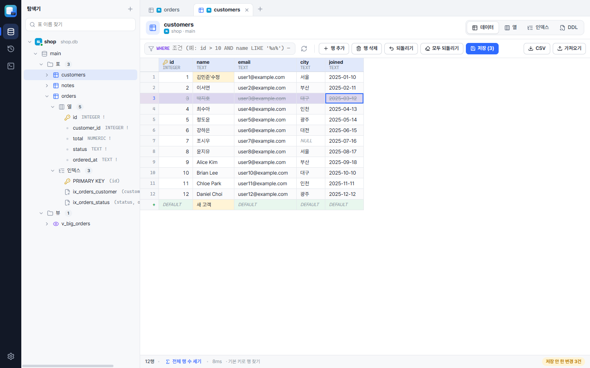

# DBoard

A database tool for Windows. Connect to SQLite, MySQL, MariaDB, PostgreSQL and SQL Server to browse tables, run SQL and edit data.

[한국어](README.md)



## Download

Get it from [Releases](https://github.com/winjun0221/dboard/releases/latest).

- `DBoard-Setup-<version>.exe` — installer (downloads new versions automatically)
- `DBoard-<version>-portable.exe` — runs without installing (no auto-update)

No Java or database client is needed. The app isn't code-signed yet, so if Windows SmartScreen warns on first launch, choose "More info → Run anyway".

## Supported databases

| Type | Also works with |
|---|---|
| SQLite | a single file (`.db`, `.sqlite`) |
| MySQL · MariaDB | MySQL-compatible databases such as TiDB |
| PostgreSQL | PostgreSQL-compatible databases such as CockroachDB and TimescaleDB |
| SQL Server | Azure SQL |

## Features

- **Connections** — save, duplicate and color connections, test before saving, SSH tunnel (password or private key), SSL
- **Explorer** — database → schema → tables and views → columns and indexes, table search
- **SQL editor** — syntax highlighting, table and column autocomplete, run the statement at the cursor or the selection (`Ctrl+Enter`), run the whole script (`Alt+X`), cancel, query history
- **Result grid** — smooth with tens of thousands of rows, click to sort, copy cells or ranges (paste straight into Excel), CSV export
- **Edit table data** — edit cells, add and delete rows, undo (`Ctrl+Z`), preview the SQL before saving, save in one transaction (everything is rolled back if anything fails)
- **DDL and CSV import** — view and copy the CREATE statement, import CSV (UTF-8 and EUC-KR detected automatically, column mapping)
- Korean and English UI, light and dark themes



## Security

- Passwords are encrypted with your Windows account (DPAPI) and can't be read by other users or PCs. Turn off "Save password" to be asked on every connect.
- The SSH server's host key is remembered on first connect; the connection is refused if it changes.
- `UPDATE` and `DELETE` without `WHERE` ask for confirmation before running.
- Edited values are sent as parameters (`?`, `$1`), never pasted into the SQL.

## Shortcuts

| Key | Action |
|---|---|
| `Ctrl+Enter` | Run the selection, or the statement at the cursor |
| `Alt+X` | Run the whole script |
| `Ctrl+Space` | Autocomplete |
| `Ctrl+/` | Toggle comment |
| `Ctrl+]` | New SQL editor |
| `Ctrl+W` · `Ctrl+Tab` | Close tab · next tab |
| `Ctrl+S` · `Ctrl+Z` | Save table data · undo |
| `Ctrl+C` · `Ctrl+Shift+C` | Copy results · copy with column names |

## Building

Requires Node.js 24.

```bash
npm install
npm run dev        # run in development
npm test           # tests
npm run test:db    # real-server tests against MySQL, MariaDB, PostgreSQL and SQL Server in Docker
npm run e2e        # UI tests that launch the app
npm run dist       # installer → release/
```

MIT license. Licenses of bundled third-party packages are in [THIRD_PARTY_NOTICES.md](THIRD_PARTY_NOTICES.md).
