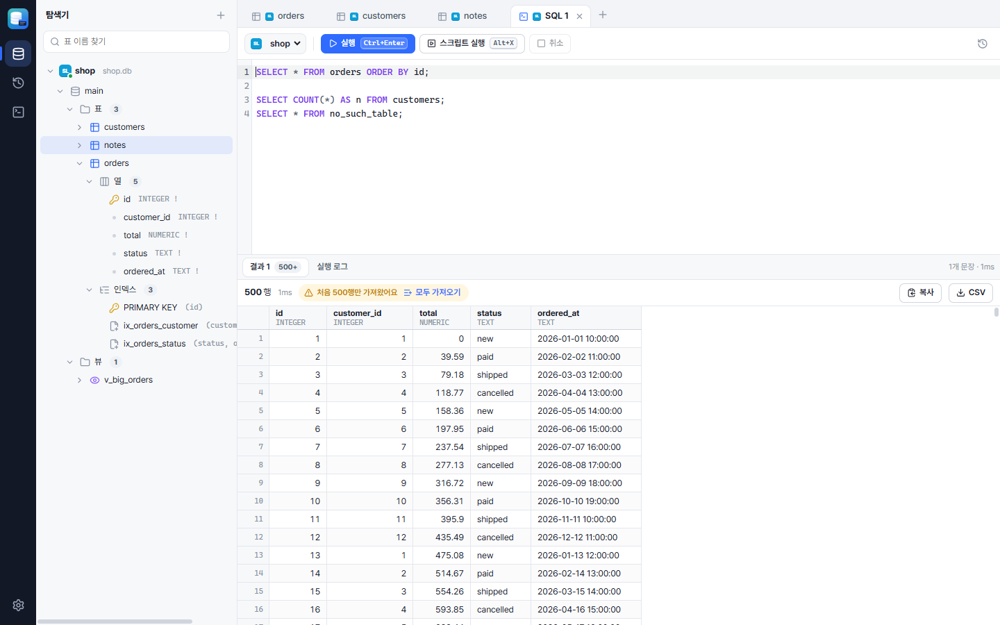
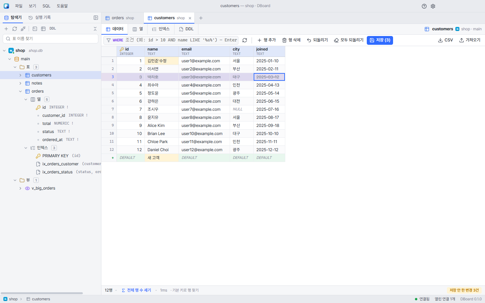

# DBoard

Windows용 DB 관리 도구예요. SQLite · MySQL · MariaDB · PostgreSQL · SQL Server에 붙어서 표를 둘러보고, SQL을 실행하고, 데이터를 고칠 수 있어요.

[English](README.en.md)



## 내려받기

[Releases](https://github.com/winjun0221/dboard/releases/latest)에서 받으세요.

- `DBoard-Setup-<버전>.exe` — 설치 파일 (새 버전이 나오면 자동으로 받아 둠)
- `DBoard-<버전>-portable.exe` — 설치 없이 바로 실행 (자동 업데이트 없음)

Java나 DB 클라이언트를 따로 깔 필요가 없어요. 코드 서명이 아직 없어서 처음 실행할 때 Windows SmartScreen 경고가 나오면 "추가 정보 → 실행"을 눌러 주세요.

## 지원하는 DB

| 종류 | 같이 쓸 수 있는 DB |
|---|---|
| SQLite | 파일 하나 (`.db`, `.sqlite`) |
| MySQL · MariaDB | TiDB 등 MySQL 호환 DB |
| PostgreSQL | CockroachDB · TimescaleDB 등 PostgreSQL 호환 DB |
| SQL Server | Azure SQL |

## 할 수 있는 것

- **접속 관리** — 접속 정보 저장·복제·색 표시, 연결 시험, SSH 터널(비밀번호·개인 키), SSL, **운영 DB 표시**(편집기가 수동 커밋으로 시작·바꾸는 문장은 실행 전에 확인·빨간 표시), **읽기 전용 접속**, **접속 폴더**, 접속 목록 내보내기·가져오기(비밀번호는 빼고), **세션 관리자**(서버에 붙은 연결·실행 중인 쿼리 보기, 쿼리 취소·연결 끊기)
- **탐색기** — DB → 스키마 → 표·뷰 → 열·인덱스, **프로시저·함수·트리거·시퀀스·이벤트**(더블클릭하면 원본을 편집기로), 표 이름 찾기, 표·뷰 이름 바꾸기·비우기·지우기(실행할 SQL을 먼저 보여 줌)
- **표 설계** — 새 표 만들기, 열(이름·타입·NULL·기본값·자동 증가·설명)·기본 키·인덱스·외래 키 고치기. 바뀐 것을 ALTER 문으로 미리 보고 실행(SQLite처럼 ALTER로 못 하는 바뀜은 표를 새로 만들어 데이터를 옮김)
- **SQL 편집기** — 문법 색칠, 자동 완성(입력하면 뜨고 `Tab`으로 넣기 · 표 이름, FROM에 쓴 표의 열, `별칭.열`), 커서 문장·고른 부분만 실행(`Ctrl+Enter`), 스크립트 전체 실행(`Alt+X`), 실행 중 취소, 실행 기록, **수동 커밋**(커밋·롤백 단추), **SQL 정렬**(`Ctrl+Shift+F`), **실행 계획**(`Ctrl+Shift+E`, 실행하지 않음), **쿼리 변수**(`:이름`·`${이름}` — 실행 전에 값 묻기), **코드 템플릿**(`sel`·`cnt`·`ins`·`upd`·`del` + `Tab`), 표 이름 `Ctrl+클릭`으로 데이터 열기·올려 두면 열 목록
- **SQL 스크립트 파일** — `.sql`로 저장(`Ctrl+S`)·열기(`Ctrl+O`), 스크립트 목록(스크립트 폴더·최근 파일), 다시 켜면 열려 있던 편집기 그대로
- **결과 표** — 수만 행도 가볍게, 열 눌러 정렬, 칸·범위 복사(엑셀에 바로 붙여 넣기), 고른 칸 합계·평균·최소·최대, 행 세로 보기, 내보내기(CSV·엑셀·JSON·Markdown·INSERT 문)
- **표 데이터 고치기** — 칸 고치기·행 추가·삭제, 되돌리기(`Ctrl+Z`), 저장 전에 실행할 SQL 미리 보기, 한 트랜잭션으로 저장(하나라도 실패하면 전부 되돌림), 외래 키 따라가기(참조하는 행 열기), 고른 행을 INSERT·UPDATE·DELETE 문으로 복사, 값 보기(JSON 보기 좋게·이미지·16진수, 파일로 저장)
- **DDL 보기 · CSV 가져오기** — 표 만드는 SQL 보기·복사, CSV 넣기(UTF-8·EUC-KR 자동 인식, 열 짝짓기)
- **SQL 덤프 · SQL 파일 실행** — DB·스키마·표를 구조(DDL)·데이터(INSERT)로 `.sql` 파일에 뽑기(외래 키 순서·자동 번호·계산 열을 맞춰서 다른 DB에 그대로 넣을 수 있게), `.sql` 파일을 골라 차례로 실행(오류가 나면 멈추고 되돌림)
- 한국어·영어 화면, 밝은·어두운 테마



## 안전

- 비밀번호는 Windows 계정 암호화(DPAPI)로 저장해요. 다른 사용자·PC에서는 풀 수 없어요. "비밀번호 저장"을 끄면 연결할 때마다 물어봐요.
- SSH 서버의 호스트 키는 처음 연결할 때 기억하고, 바뀌면 연결하지 않아요.
- WHERE 없는 `UPDATE`·`DELETE`는 실행 전에 한 번 더 물어봐요.
- 표 데이터를 고칠 때는 값을 SQL에 직접 넣지 않고 자리 표시(`?`, `$1`)로 보내요.

## 단축키

| 키 | 하는 일 |
|---|---|
| `Ctrl+Enter` | 고른 부분, 없으면 커서가 있는 문장 실행 |
| `Alt+X` | 스크립트 전체 실행 |
| `Ctrl+Space` · `Tab` | 자동 완성 띄우기 · 넣기 |
| `Ctrl+/` | 주석 켜고 끄기 |
| `Ctrl+Shift+F` · `Ctrl+Shift+E` | SQL 정렬 · 실행 계획 |
| `Ctrl+S` · `Ctrl+Shift+S` · `Ctrl+O` | SQL 파일로 저장 · 다른 이름으로 · 열기 |
| `Ctrl+클릭` | 편집기의 표 이름: 데이터 열기 |
| `Ctrl+]` | 새 SQL 편집기 |
| `Ctrl+W` · `Ctrl+Tab` | 탭 닫기 · 다음 탭 |
| `Ctrl+S` · `Ctrl+Z` | 표 데이터·표 설계 저장 · 되돌리기 |
| `Ctrl+C` · `Ctrl+Shift+C` | 결과 복사 · 열 이름과 함께 복사 |

## 직접 빌드

Node.js 24가 필요해요.

```bash
npm install
npm run dev        # 개발 실행
npm test           # 테스트
npm run test:db    # Docker로 MySQL·MariaDB·PostgreSQL·SQL Server를 띄워 실제 서버 테스트
npm run e2e        # 앱을 띄워 화면 테스트
npm run dist       # 설치 파일 → release/
```

MIT 라이선스. 같이 들어간 외부 패키지의 라이선스는 [THIRD_PARTY_NOTICES.md](THIRD_PARTY_NOTICES.md)에 있어요.
